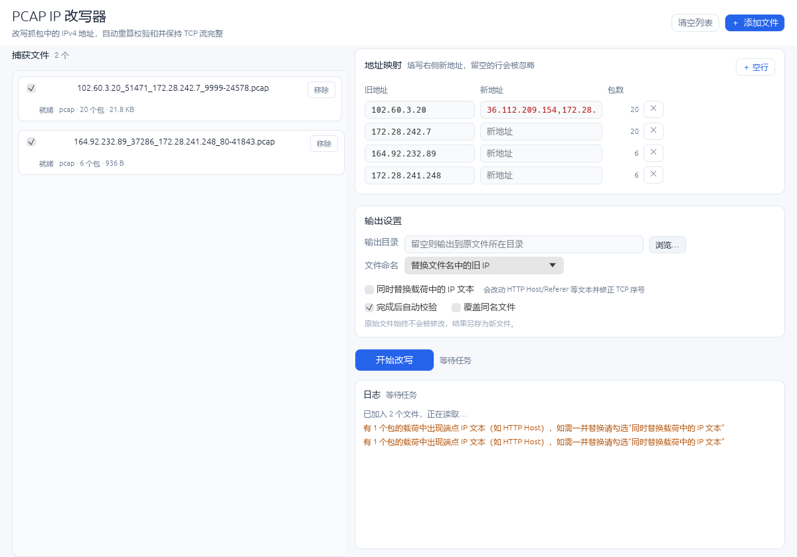
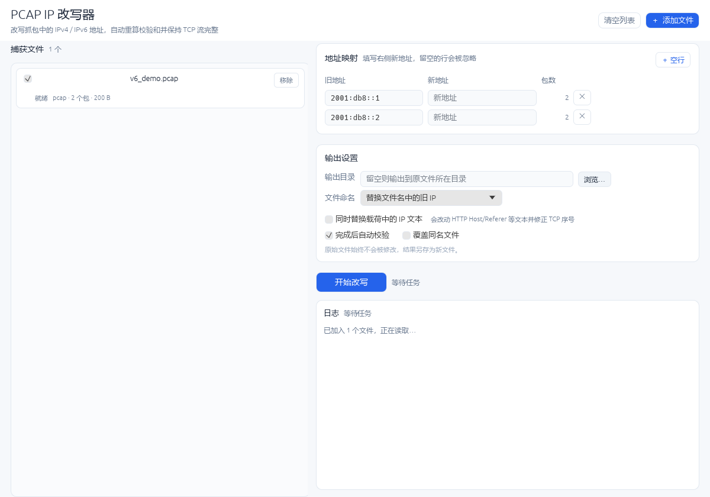

# PCAP IP 改写器（Rust 版）

改写 pcap / pcapng 抓包中的 IPv4 与 IPv6 地址，自动重算 IP 与 TCP/UDP 校验和，并保持 TCP 流可以正常重组。单个 exe，不需要安装 Python 或任何运行库。

## 下载

不想自己编译的话，直接取预编译版本：

- [pcap-rw.exe（v0.3.0）](https://github.com/aliex9527/pcap-rw/releases/download/v0.3.0/pcap-rw.exe) —— Windows x64 单文件，8.35 MB，支持 IPv4 与 IPv6
- [全部版本](https://github.com/aliex9527/pcap-rw/releases)

SHA256：`02c00c8d11cdaf07d94356fa478cc4887f079b9579d96e14d1c549b15c94a39c`

exe 带一个自签名（`CN=aliex9527 pcap-rw`），能验证文件未被改动；自签名不在公共 CA 的信任链里，首次运行仍会看到「未知发布者」，属正常现象。

## 功能

- **地址替换**：按映射表改写源地址与目的地址，IPv4 与 IPv6 同时支持，双向生效。
- **校验和重算**：IPv4 头校验和、TCP/UDP 校验和（含伪首部；IPv6 使用 16 字节地址的 40 字节伪首部）。分片报文会先做重组再计算，避免首片校验和错误。
- **IPv6 扩展头**：逐级解析 Hop-by-Hop、Routing、Destination Options、AH 与 Fragment 头，再定位真正的上层协议与偏移；Fragment 头之后的 Destination Options / AH 也能正确定位，非首片则止于分片头。
- **缺首片的兜底**：抓包里丢了偏移为 0 的那个分片时，扩展头长度也随之丢失。此时按 8 字节对齐在存活数据里寻找上层协议头，用原始校验和（它对整个数据报求和）判定唯一候选，能定位就照常重算校验和；实在定位不到才跳过并明确提示。
- **链路层兼容**：Ethernet、802.1Q VLAN、QinQ 双层标签、Linux SLL / SLL2、RAW IP、Null 链路类型。
- **格式兼容**：经典 pcap（大端/小端、微秒/纳秒）与 pcapng（EPB / PB / SPB），未知块与 EPB 选项原样保留。
- **载荷文本替换**：可选替换 HTTP `Host`、`Referer` 等处的 IP 文本；长度变化时自动平移同一 TCP 流的后续 `seq`/`ack`，并重算长度字段。
- **安全护栏**：检测到分片、截断或 TCP 重传/乱序时，自动对该文件关闭载荷替换，只改 L3 头，避免破坏流。
- **写后校验**：重新读取输出文件，逐包验证 IP/L4 校验和，并确认旧地址没有残留。

## 图形界面

双击 `pcap-rw.exe` 即可。程序按窗口程序（GUI 子系统）链接，启动不会弹出黑色命令行窗口。拖入 pcap 文件后会自动扫描端点并列出映射行，只需填写「新地址」一列。

- 左侧是文件列表，可用复选框临时排除某个文件。
- 右侧填写映射、输出目录与选项，点「开始改写」。
- 原始文件永远不会被覆盖，结果另存为新文件；命名支持替换旧 IP、追加 `_new` 或保持原名。
- 界面底部实时显示进度与逐文件结果。



导入含 IPv6 的抓包时，「旧地址」列会直接填出 `2001:db8::1` 这样的端点，填好新地址即可改写：



## 命令行

```text
pcap-rw scan <文件> [--pairs]                查看端点与流量分布
pcap-rw rewrite <文件...> --map 旧=新 [-o 目录] [--payload] [--verify] [--overwrite]
pcap-rw verify <文件> --old 旧IP [--payload]
```

示例：

```bat
pcap-rw rewrite capture.pcap --map 10.0.0.5=192.168.1.5 --map 10.0.0.6=192.168.1.6 --verify
```

`--map` 可以重复多次。`--payload` 会连同请求文本里的旧 IP 一起替换。

IPv6 写法相同，`::` 压缩形式和内嵌点分（`::ffff:10.0.0.1`）都能识别：

```bat
pcap-rw rewrite v6.pcap --map 2001:db8::1=2001:db8:ffff::1 --map 2001:db8::2=2001:db8:ffff::2 --verify
pcap-rw scan v6.pcap --pairs
```

同一份映射表里可以混排 IPv4 与 IPv6 规则，一个文件里两种报文都会被处理。地址族不能混用（IPv4 换成 IPv6 会直接报错），因为长度不同，无法写回原字段。

带参数启动时程序会自动接管所在 shell 的控制台，输出照常可见（重定向到文件或管道也一样）。因为它被标记为窗口程序，cmd 不会等待它结束；需要等待时用 `start /wait pcap-rw rewrite ...`。

## 构建

需要 Rust 与 `dlltool`（MinGW binutils，用于生成导入库）。

```bat
set PATH=C:\path\to\mingw\bin;%PATH%
cargo build --release
```

产物为 `target\release\pcap-rw.exe`。项目内的 `.cargo/config.toml` 使用 Rust 自带的 `rust-lld` 作为链接器，并启用自包含链接，因此不依赖系统的 MSVC 或完整 MinGW 工具链。

### 一条命令出包

编译器只负责出裸 exe，图标和版本资源是之后补上去的。`tools\build.ps1` 把这几步串起来：

```bat
powershell -ExecutionPolicy Bypass -File tools\build.ps1
```

顺序是 `cargo build` → 留存裸产物 `dist\pcap-rw.raw.exe` → 拷成 `dist\pcap-rw.exe` → 图标 → 版本资源 → 签名。签名默认开启，不想要时加 `-NoSign`（见下一节）。

之所以每次都从 `pcap-rw.raw.exe` 重新拷一份，是因为 `seticon.py` 会重写整个资源段并把已有签名丢掉；在已签名的 exe 上再跑一次，结果是一个带着失效证书表、后续也签不上的半成品。需要只重跑后处理时加 `-SkipBuild`。

### exe 图标

`assets/app.ico` 会在运行时作为窗口与任务栏图标加载。若还想让资源管理器里的 exe 显示图标，可执行：

```bat
python tools\seticon.py dist\pcap-rw.exe assets\app.ico
```

该脚本通过 Win32 资源 API 写入 `RT_ICON` / `RT_GROUP_ICON`，不依赖 `windres`。

### 版本资源

exe 原本没有版本信息，属性对话框里是空的。`tools\version.py` 从 `Cargo.toml` 读版本号，手工拼出 `VS_VERSIONINFO` 再写进 `RT_VERSION`（同样绕开 `windres`），因此在资源管理器里能看到 `0.2.2.0`、产品名和公司名。改版本号只需改 `Cargo.toml` 后重跑。

注意资源写入必须发生在签名之前：签名覆盖的是整个文件，之后再改资源会让签名失效。

## 代码签名

发布的 exe 带一个自签名（`CN=aliex9527 pcap-rw`）。构建脚本默认就会签，证书存放在 `certs\`（已被 `.gitignore` 排除，私钥不进仓库）：

```bat
:: 1. 只跑一次，生成 certs\pcap-rw-signing.pfx / .cer / .password
powershell -ExecutionPolicy Bypass -File tools\make-signing-cert.ps1

:: 2. 单独给某个文件签名（默认向 DigiCert 打时间戳，断网时加 -NoTimestamp）
powershell -ExecutionPolicy Bypass -File tools\sign.ps1 dist\pcap-rw.exe

:: 3. 可选：让本机信任这张自签证书，签名状态才会显示 Valid
powershell -ExecutionPolicy Bypass -File tools\trust-cert.ps1
```

证书为 `CN=aliex9527 pcap-rw`，RSA 3072 / SHA-256，有效期 5 年。签名后文件尾部会多出约 7.6 KB 的 PKCS#7 块，不影响运行。

**去掉签名**：不要手工截断文件，用 `tools\build.ps1 -NoSign` 从 `dist\pcap-rw.raw.exe` 重新生成一份——它会重写资源段并顺带清掉证书表，其余字节保持不变。

自签名证书解决的是「文件有没有被人改过」——任何人拿到 `.cer` 都能验证签名与文件内容一致；它**不能**消除 SmartScreen 或「未知发布者」提示，因为那些提示取决于证书是否由公共 CA 签发以及下载量积累的声誉。要让普通用户双击不报警，需要 OV/EV 证书或 Azure Artifact Signing 之类的服务。

文档里提到的 `certs\.password` 是随机 24 位密码，丢了就只能重新生成证书并重签所有产物，请一并备份。

## 性能

5 万个 TCP 包（15 MB，含载荷替换与写后校验）：

| 实现 | 耗时 |
|---|---|
| Rust（release） | 0.53 s |
| Python 版 | 2.98 s |

两者输出逐字节一致。

## 测试

```bat
cargo test
```

集成测试用合成报文覆盖：VLAN/QinQ、UDP、IPv4 分片重组、TCP 序号平移（增/减）、重传保护、大端 pcap、pcapng 选项保留、截断包降级、长地址前缀不误匹配，以及 IPv6 的 TCP/UDP 改写、Hop-by-Hop 扩展头、Fragment 头与首片校验和、Fragment 头之后的 Destination Options（首片校验和 + 各分片地址改写 + 分片数据不被误认成扩展头）、首片缺失时的校验和兜底（完整丢失 / 首片停在扩展头中间 / 确实无法定位三种情形）、v6 文本替换、v4/v6 混跑。

## 实现说明

- 载荷替换只替换完整地址，前后不能紧邻数字、点、冒号或十六进制字符，因此 `10.1.2.33` 不会被 `10.1.2.3` 的规则破坏，`2001:db8::10` 也不会被 `2001:db8::1` 误伤。
- 地址统一表示为 `Ip` 枚举（4 字节或 16 字节），映射表、流表、端点统计共用同一套代码路径。
- IPv6 没有头部校验和，只重算上层校验和；长度变化时同时修正 IPv6 载荷长度字段和 UDP 长度字段。
- IPv6 扩展头逐级跳过（上限 16 跳，防止畸形链死循环），最终以真实的 next header 计算伪首部；遇到非首片的分片头就停下，因为其后的字节是分片数据而不是头部。
- 分片重组以 Fragment 头之后为起点（分片偏移就是相对这个位置的）。首片如果在 Fragment 头后面还带着 Destination Options / AH，这些头属于「可分片部分」，会先从重组缓冲区里按位移切掉，再算传输层校验和。
- IPv6 分片用 Fragment 头里的 32 位标识做重组键，与 IPv4 的 16 位标识互不干扰。
- TCP 序号平移按流（源/目的地址 + 端口）累积，反向流的 `ack` 使用反方向累计值。
- 分片重组的键：IPv4 为（源、目的、16 位标识、上层协议），IPv6 为（源、目的、32 位标识）——IPv6 的上层协议可能藏在只有首片才有的扩展头后面，不能参与分组。只在前缀连续时才认为重组成功；不完整分片会跳过并给出提示。
- 缺首片时扩展头长度未知，协议头位置只能推断：候选位置限定在存活数据的 8 字节对齐处（扩展头长度都是 8 的倍数），按 TCP/UDP 校验和判定 —— 校验和覆盖整个数据报，而候选位置之后的所有字节都在抓包里，所以正确位置算出来必然为 0。只有 32 位校验和这一层会漏判，所以再补两条结构性约束：UDP 长度字段必须正好等于剩余字节数、端口不能为 0；结构上出现两个候选就当作无法确定，不做猜测。IPv4 不走这条路 —— 它的分片数据紧跟 IP 头，传输层头必然在第 0 字节，丢了首片就等于丢了头。
- 写文件采用「临时文件 + 重命名」，中途失败不会留下半个文件。
